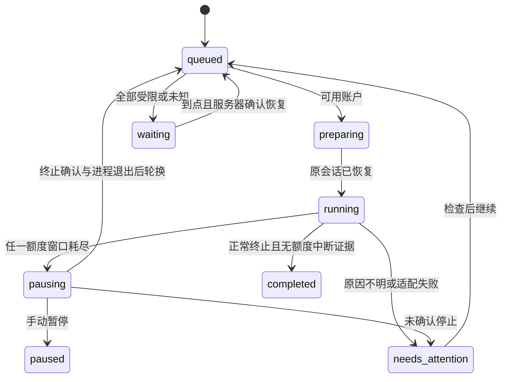

# 架构与状态约束

Renderer → 隔离 preload → Electron 主进程 → Scheduler → CLI / Desktop worker。CLI 查看器通过带随机认证令牌的 Windows 命名管道调用同一主进程。调度器顺序运行任务，账户轮换也必须先结束旧 worker。

账户目录与任务目录分离。账户目录负责官方登录、令牌刷新、额度读取；任务目录永久保留原 thread 的 rollout 与工作记录。CLI worker 通过实验性 `chatgptAuthTokens` 获取内存中的访问令牌，刷新时请求账户目录更新，避免把同一 refresh token 交给多个并发进程。客户端运行期间拥有该账户的刷新权限，账户探针暂停，额度探针仅使用客户端最新 access token。

实现中额度终止还会短暂持久化 `rotating`，随后 `queued`；重启时 `preparing/running/pausing/rotating` 转为恢复待处理，冻结整个队列。

## 必须保持的不变量

1. `usageLimitExceeded`、明确额度耗尽文案或任一已知窗口 usedPercent ≥ 100，优先于成功终止状态。本轮额度证据是粘性的，之后额度读数恢复不会抹去它。
2. RPC 中断 ACK 不是终止确认；终止事件后仍要关闭旧进程树。停止确认失败冻结调度，不自动并行启动另一个 worker。
3. 会话 ID 必须来自真实协议/rollout。切号后 `thread/resume` 同一 ID，随后提交继续提示，不新建空白任务。
4. 服务端重置时间不是额度到账证明。经过时间不能直接把 100% 使用率改为 0%。
5. 稀疏通知未携带的窗口沿用上次观测；完整额度读取可清空已不存在的窗口。只有未知窗口的账户不被视为无限额度。
6. 每个账户只有一个刷新令牌管理者；加密写回成功后才能删掉更新后的暂存文件。
7. 每个受管 app-server 目录保存 PID/nonce 占用标记，活进程标记不被自动清除。异常重启先处理旧任务，再执行队列中任何新任务。
8. 手动暂停/取消优先于自动额度轮换；用户主动暂停后不会自己恢复。

## 客户端适配边界

客户端没有供任意外部程序控制现有 UI 任务的稳定公开接口。本适配器创建专属会话，必要时先 archive/unarchive 让空线程落盘，设置唯一标题，再启动独立客户端实例。命中唯一会话控件、唯一空输入框和唯一发送按钮后才发送内容。之后以该目录、该 thread 的 rollout 为准，检测 task_started、task_complete、turn_aborted、error 和 token_count。

每 10 秒检查 CDP 连接，每 500 毫秒增量读取 rollout；JSONL 跨块 UTF-8/半行缓冲，文件截断拒绝继续。停止按钮仅发出请求，仍等待真实终止记录。客户端关闭后先持久化它更新的凭据，再允许下一账户。

CDP 仅绑定本机环回地址和专属 profile。它不是隔离同一 Windows 用户下恶意软件的安全边界；DPAPI 同样不能保护凭据免受同用户进程访问。

## 完成的含义

只认正常结束且无额度中断证据的一轮 Codex turn。完成目标的语义依赖 Codex 和用户描述的验收标准。暂停、断网、错误、缺少选择器、需要审批、需要重新登录都不会被标记为任务完成。网络错误有退避；未知错误保留任务等待处理，防止盲目重复外部操作。
