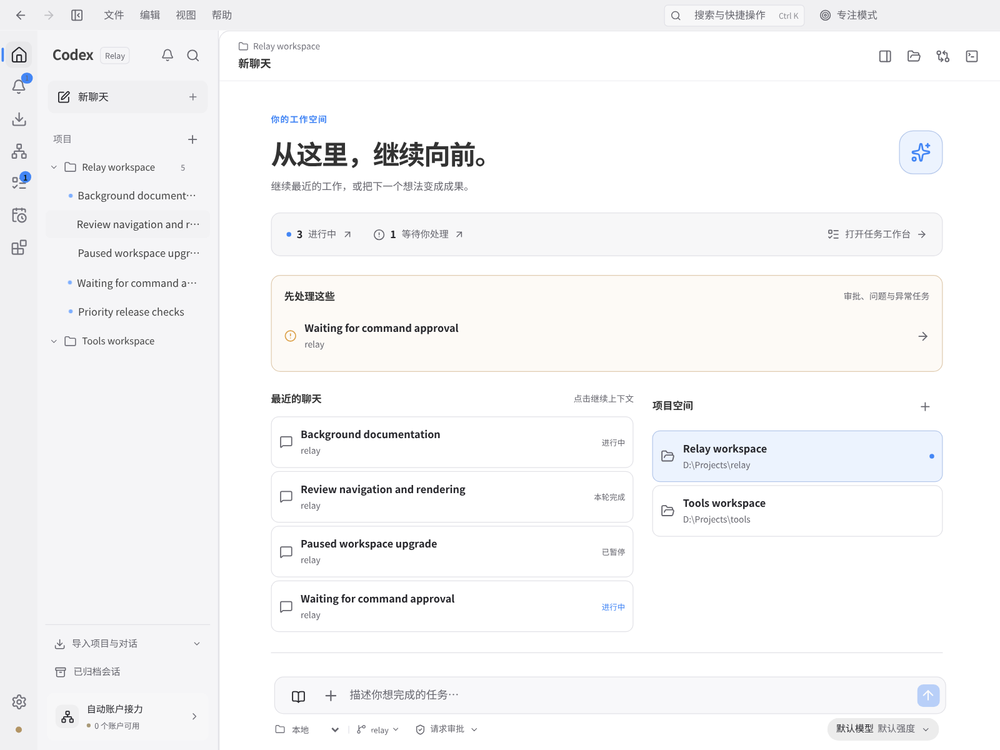
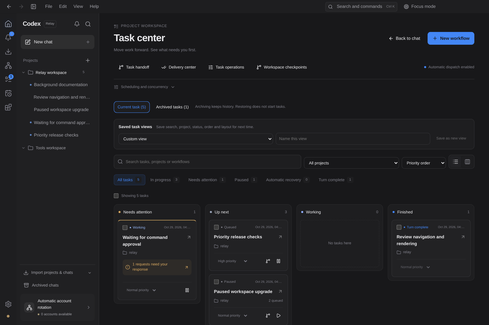
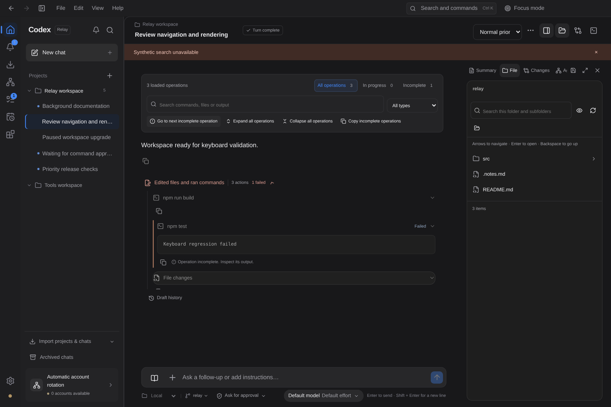
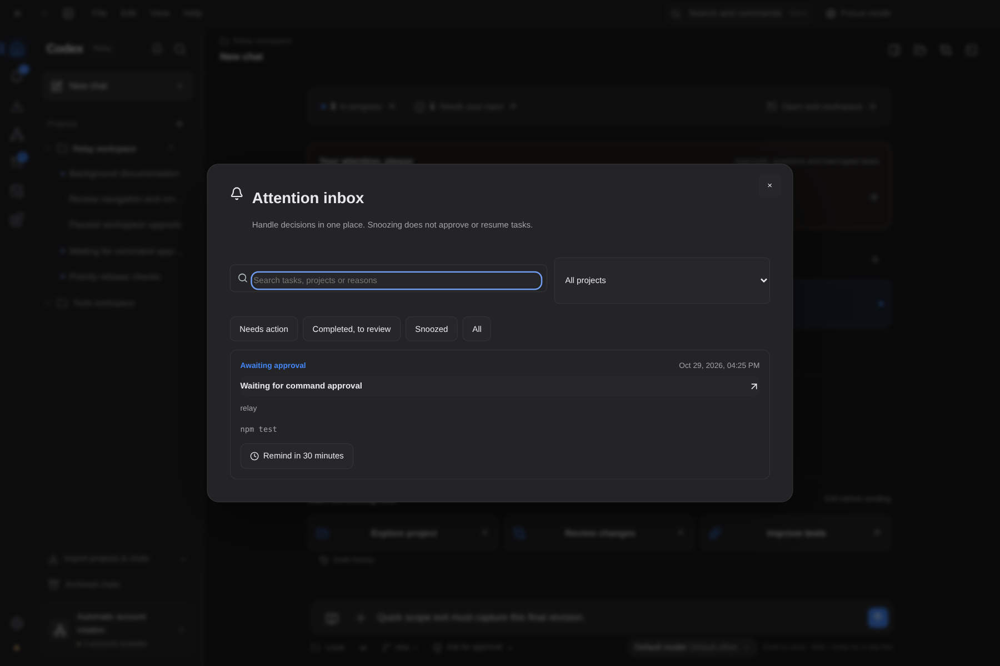
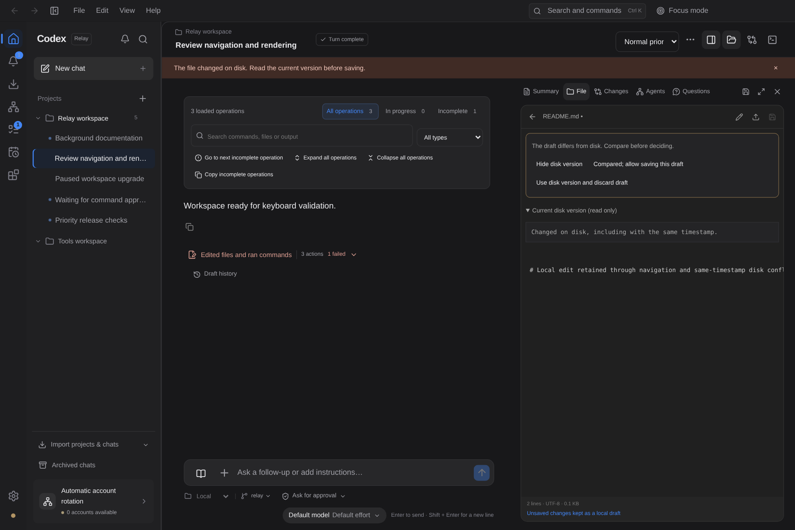

# 分支整合与十轮 Windows 体验迭代

按要求先逐个比较并合并分支，再开展十轮开发。没有删除远端分支，没有强推或重写分支历史。

## 分支先整合

- `codex/auto-recovery-20261022`：完全包含在原 main 中，不重复应用。
- `codex/continuation-20261027`：45 个独有提交，完整合并。保留提交／追问回执、重启与 Goal 权限、计划／模板验收和远程恢复。
- `wip/windows-handoff-20261025-5011a26c`：4 个独有提交，完整合并交接封存、内容与索引审阅、候选生成、接管权限和原生仓库锁。保留 Windows 原生专项验证边界。
- 合并时修复 Git 快速退出导致 stdout 在异步读取器准备前被排空的真实竞态；立即接管有界流、保留反压、拒绝未读完即返回的消费者。原有输入完整性、非零退出与长路径保护保留。

[逐分支、逐提交审计和冲突处理记录](BRANCH-INTEGRATION-20261029.md)。

## 十轮交付

| 轮次 | 完整使用流程 | 关键可靠性措施 |
|---|---|---|
| [01 草稿找回](ROUND-01.md) | 预览旧版、恢复文本与附件引用、导出历史 | 项目／会话隔离；恢复前保存当前版本；快速切换刷新；待确认提交期间不覆盖 |
| [02 待办收件箱](ROUND-02.md) | 集中处理审批、问题、异常与完成项 | 稍后提醒不批准任务；到期刷新；更新后的审批、下一轮错误与完成项重新出现 |
| [03 命名任务视图](ROUND-03.md) | 保存、命名、切换、更新和删除完整筛选布局 | 查询／项目／状态／归档／排序一起恢复；损坏存储保留原始备份 |
| [04 批量归档与撤销](ROUND-04.md) | 归档、查看历史、恢复与撤销成功项 | 逐项校验、一次持久化、失败回滚；版本回执阻止旧撤销覆盖新操作 |
| [05 文件导航](ROUND-05.md) | 面包屑、键盘、隐藏文件与递归路径搜索 | 可取消、有界扫描、错误与截断提示；保留原项目范围 |
| [06 文件编辑恢复](ROUND-06.md) | 导航／刷新后找回草稿、冲突对照、Ctrl+S | canonical 文件串行写入；mtime + SHA256 防同时间戳替换；失败保留编辑区 |
| [07 排队消息编辑](ROUND-07.md) | 刷新后继续编辑、对照冲突、确认移除 | 修订号保护；消息离队后只保留可复制编辑，不自动重新发送 |
| [08 项目模板库](ROUND-08.md) | 搜索收藏、项目关联、预览追加、完整配置克隆 | 更新后二次确认；版本冲突与脏表单保护；损坏偏好不自动覆盖 |
| [09 会话证据搜索](ROUND-09.md) | 角色筛选、真实游标分页、上下文和逐处匹配 | 请求失效保护；重试失败不显示旧结果；原文高亮不改内容 |
| [10 执行记录工作台](ROUND-10.md) | 工具类型／状态／输出筛选、失败定位和复制 | 保留正文上下文；定位会打开实际折叠项；截断内容明确标记 |

每轮均有独立提交、具体实现及专项测试。最终整合另修正了 React 重复 key 导致草稿按钮累积、迟到回执与恢复草稿冲突、排队移除翻译撞键，以及弹窗内层宽度超出外框的问题。

## 验证

- TypeScript 和生产构建通过；构建清单验证源码与产物一致。
- 完整套件：144 个文件，143 通过、1 Windows 专项文件跳过；1,115 项通过、13 项平台专项跳过、0 失败。
- 十轮浏览器链全部通过：含刷新恢复、真正下载、保存冲突、部分失败、过期撤销、模板二次确认、搜索失败重试；无页面异常或重复 React key 警告。
- 深色英文 1440、浅色中文 1280、深色日文 900；额外检查弹窗内部宽度和实际控件可见性，避免仅“外框在视口内”而内容被裁切。
- 原有审阅、新聊天创建恢复和追问回执恢复浏览器用例通过，覆盖简中／繁中／英文／日文及 150% 缩放。
- 真实 headless 服务鉴权、单实例保护、任务重启持久化通过；独立服务包与构建清单检查通过。

复现浏览器：`RELAY_CHROMIUM_PATH=/usr/bin/chromium node scripts/qa/iterations-ten.cjs`。运行生产渲染器，使用可控模拟 IPC，未读取账户或调用模型。[机器可读报告](ten-browser-report.json)。

当前验证机器为 Linux；并未把这些检查宣称为真实 Windows Electron、DPAPI、原生锁强制崩溃或安装包验收。对应 Windows CI 与原生验收脚本保留，本次没有发布安装包。

## 截图

