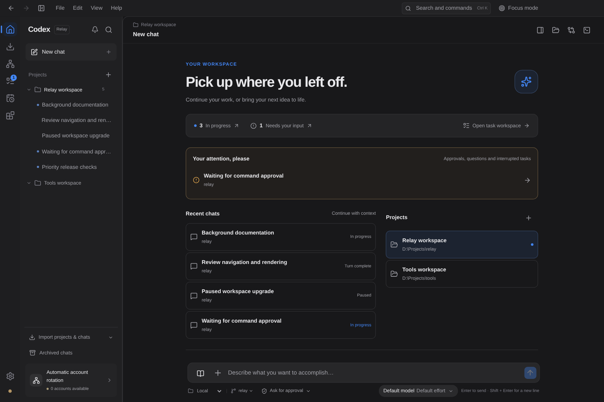
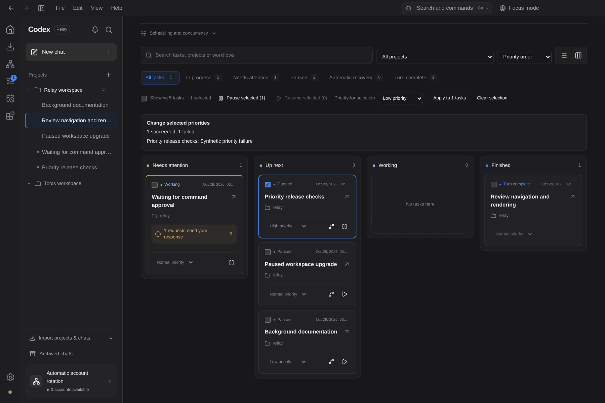
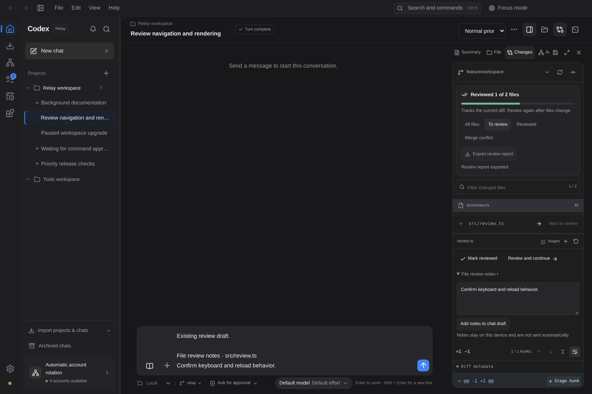

# 三轮 Windows 工作台迭代

本轮围绕“开始工作 → 管理执行 → 审阅交付”完成三个可独立审阅的提交。Windows 桌面界面与现有 IPC 保持衔接；没有调用真实模型或导入账户。

## 第一轮：可操作的工作台首页

首页集中显示审批／问题／异常任务、最近聊天和项目空间。快捷开始会追加到当前项目草稿，切换项目保留各自的草稿。项目自定义名称保留。顶部 Ctrl+K 命令面板支持聊天／项目／操作搜索、`>` 操作筛选、方向键和 Enter；中文／日文输入法确认不会误触执行，关闭后恢复焦点。

专注模式保留辅助面板状态。前进／后退记录真实页面、会话与项目草稿位置，返回后开启新的导航会截断旧的前进分支；已删除会话被跳过，历史上限为 50。首页不再被聊天自动跟随逻辑滚动到底部。

## 第二轮：任务规划与持久化批量操作

支持列表／四列状态看板、项目和工作流搜索、上下文筛选数量、三种排序与布局偏好恢复。运行中等待审批的任务出现在待处理栏。保留交付、工作流、运行台、检查点和依赖入口。

新增 `jobs.priority` 全链路：Windows IPC、调度器、服务端和鉴权 HTTP。批次最多 100 个 UUID，去重并逐项拒绝不适用任务。调度器等待已有控制完成，串行写入有效项；真实磁盘保存失败时撤回有效项的全部优先级修改。只有持久化完成才返回成功。UI 保留失败项及隐藏选择，避免把部分失败当成全部成功。

## 第三轮：可验证的代码审阅交付

审阅进度按项目保存，暂存区和工作区分别记录。标记绑定 Git 状态与显示差异的 SHA256。刷新会重新读取已标记差异，因此文件内容变化但 Git 状态指纹不变时也会失效；二进制、无法解码或不能核验的内容不能标记。

新增待审阅／已审阅／冲突筛选、前后文件导航、审阅并继续、逐文件笔记及显式追加聊天草稿。下载 Markdown 报告前重新验证，报告包含项目、分支、状态指纹、UTC 采集时间、各侧差异 SHA256、未验证项与笔记。报告表达采集时的审阅状态，不代表测试通过或合并批准。原有暂存操作仍在 Git 串行临界区校验完整差异和 revision。

修复检查点恢复中真实 Git `index-pack` 已接收完整 pack 却先关闭 stdin、导致 Node pipeline 报 `ERR_STREAM_PREMATURE_CLOSE` 的竞态。新实现等待每块写入和源文件 EOF，仍拒绝提前关闭、未写完数据及非零进程退出。回归测试通过真实子进程和延迟 EOF 稳定复现旧行为；100 次真实 Git pack 导入压力检查通过。

## 验证记录

- `npm run check`：TypeScript、生产构建及完整套件通过；100 个测试文件，752 通过、12 跳过、0 失败。跳过项为原有平台专项边界。
- `node scripts/qa/headless.cjs`：真实服务、鉴权 CLI/HTTP、单实例保护和任务重启持久化通过。
- `RELAY_CHROMIUM_PATH=/usr/bin/chromium node scripts/qa/windows-workspace.cjs`：生产渲染器运行于 Chromium，Windows 平台模拟 IPC。验证草稿、导航、IME、命令面板、看板、优先级／暂停／恢复、部分失败、审阅重载失效与实际报告下载，0 页面错误。
- 深浅主题、中英日、900／1100／1280／1440 宽度：五组布局无页面溢出。现有 `review-ui.cjs` 和中文 `workspace-visual.cjs` 回归也通过。
- [机器可读浏览器结果](windows-workspace-report.json)。截图使用合成任务，无账户信息。

当前云实例为 Linux；以上不代表已在真实 Windows Electron、DPAPI、原生进程管理或安装包中验收。Windows CI 保留原生构建和测试，未在这里生成或发布 Windows 安装包。

检查点测试现使用跨平台绝对临时路径，并保留删除边界检查。远程 CLI 测试在非 Windows 上只省略无法生成的原生二进制复制，实际 JavaScript 客户端用例继续执行；Windows CI 仍要求声明的原生产物存在。
